# Kubernetes in plaatjes

Een spiekbrief om de begrippen uit deel 2 te onthouden. Elk plaatje heeft een vergelijking die
het makkelijker maakt.

> **Zien:** GitHub toont deze diagrammen vanzelf. In VS Code installeer je de extensie
> *Markdown Preview Mermaid Support*, en open je de preview met **Cmd+Shift+V**.

**De vergelijking voor alles hieronder: een kantoorgebouw.**

| Kubernetes | Kantoor |
|---|---|
| cluster | het gebouw |
| control plane (het brein) | de directie en de planning |
| node | een verdieping |
| pod | een medewerker |
| namespace | een afdeling (verspreid over verdiepingen) |
| Deployment | de vacature: "we willen altijd 3 van deze" |
| Service | het algemene telefoonnummer van de afdeling |
| Gateway | de receptie, voor bezoekers van buiten |

---

## 1. Wat is een cluster?

Een cluster = **het brein + de nodes**. Je praat altijd met het brein, nooit direct met een node.

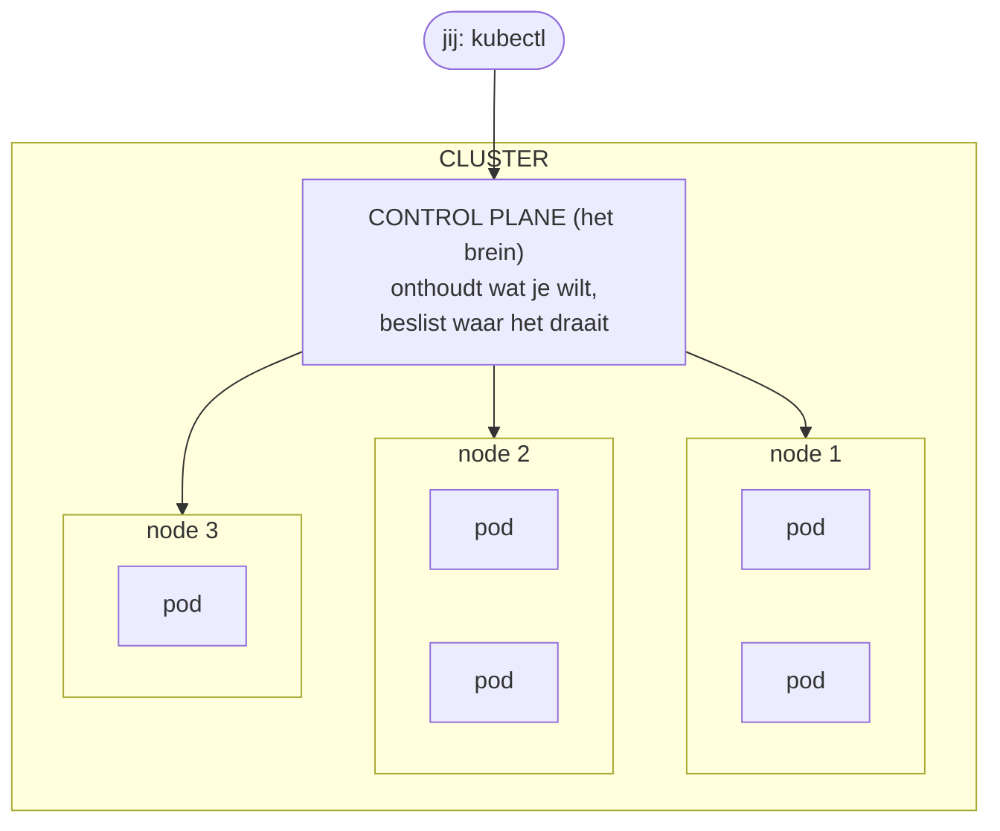

| Begrip | In één zin |
|---|---|
| **cluster** | het hele systeem: brein + nodes |
| **node** | één machine (VM) waar pods op draaien |
| **pod** | een verpakking om (meestal één) container |

In **kind** zijn brein en node samen één container op je Mac. Op **AKS** zie je het brein niet:
dat beheert Microsoft.

---

## 2. Nodes zijn verticaal, namespaces zijn horizontaal

Een node is een **machine**. Een namespace is een **map** voor je spullen, dwars over alle
machines heen. Elke pod staat op één kruispunt: één namespace, één node.

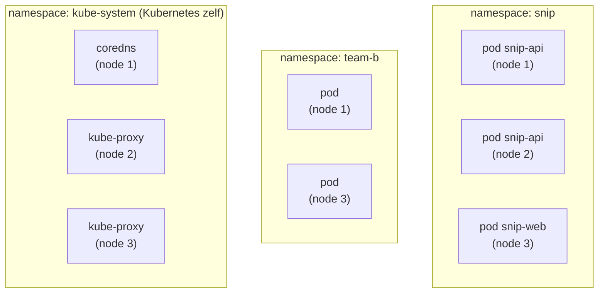

| | Node | Namespace |
|---|---|---|
| richting | verticaal | horizontaal |
| wat is het | een machine | een map / afdeling |
| wie kiest | de scheduler (automatisch) | jij (`-n`, of in de YAML) |
| typisch per | — | app, team of omgeving (niet per onderdeel!) |

API en website van **dezelfde app** staan in **dezelfde** namespace.

---

## 3. Deployment: "er moeten er altijd 3 zijn"

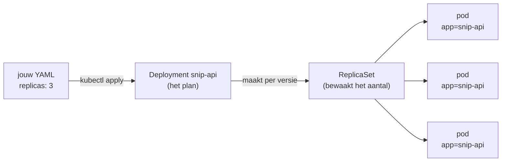

**De lus die alles draaiende houdt:**

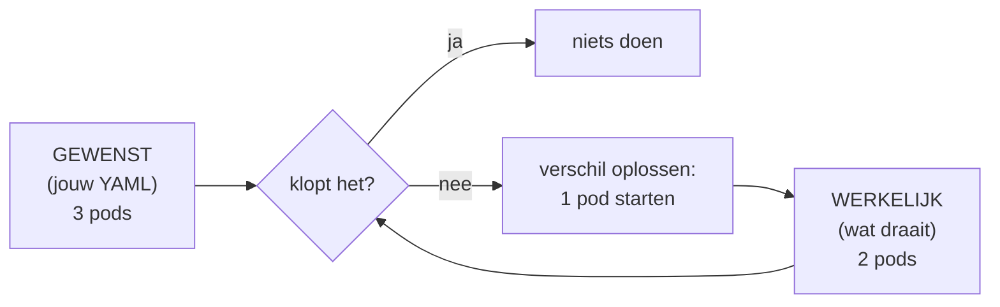

| Situatie | Wat Kubernetes doet |
|---|---|
| pod crasht of wordt verwijderd | nieuwe pod starten |
| `replicas: 3` → `5` in het bestand | 2 bijmaken |
| `kubectl scale` naar 5, daarna `apply` | terug naar wat het **bestand** zegt |
| nieuwe image-tag in het bestand | rolling update (zie 6) |

---

## 4. Etiketten: de lijm

Deployment en Service kennen elkaar niet. Ze vinden **dezelfde pods** via hetzelfde etiket.

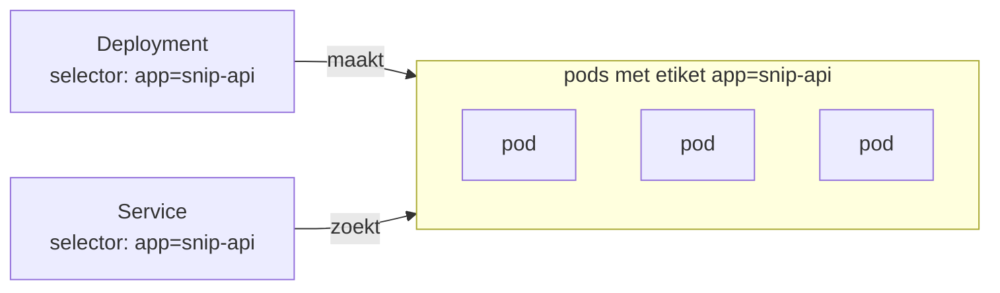

**Tikfout in een etiket?**
- in een **Deployment**: foutmelding (`selector does not match template labels`);
- in een **Service**: **geen** foutmelding, maar nul endpoints. Altijd eerst checken:
  `kubectl describe svc NAAM` → `Endpoints`.

---

## 5. Service: één vast nummer voor wisselende pods

Pods wisselen van adres. De Service maakt die **niet** vast, maar heeft een **eigen** vaste naam
en een eigen vast adres.

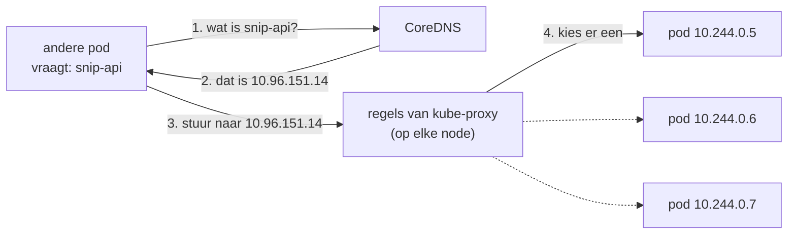

**Wie houdt wat bij?**

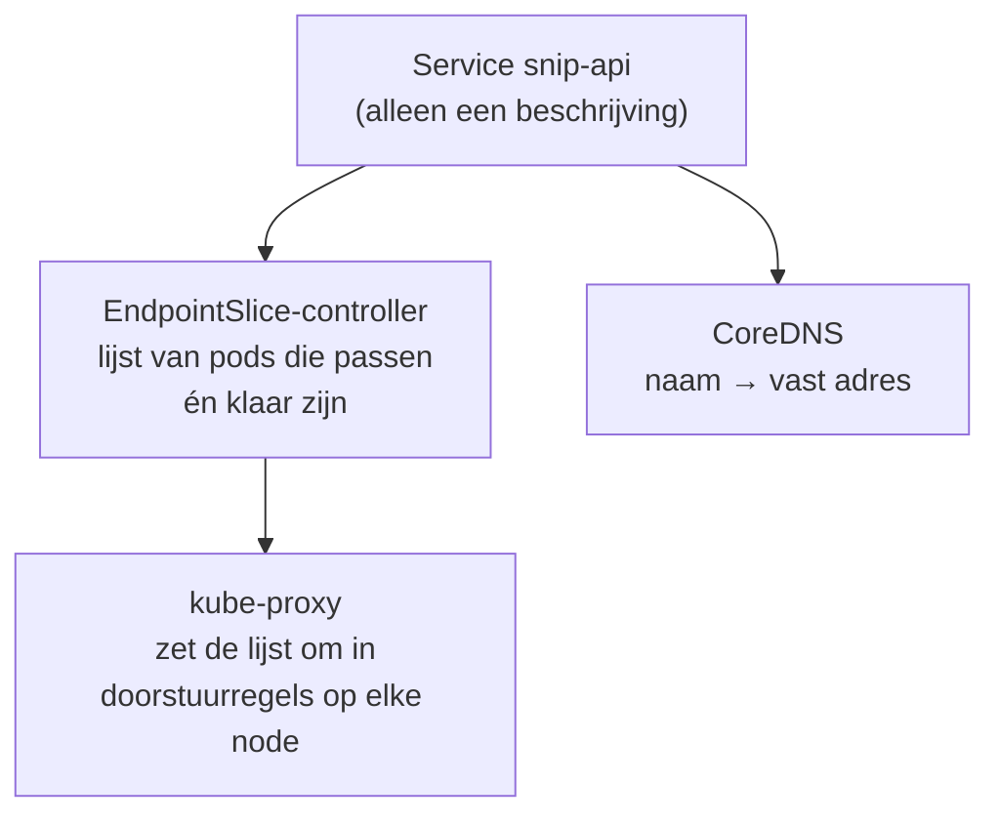

**Soorten Services** (elke volgende bevat de vorige):

| Type | Bereikbaar vanaf | Kantoor |
|---|---|---|
| **ClusterIP** | alleen binnen het cluster | intern telefoonnummer |
| **NodePort** | + een poort (30000–32767) op elke node | + een zijdeur op elke verdieping |
| **LoadBalancer** | + een publiek IP van de cloud | + een eigen buitendeur |

---

## 6. Een nieuwe versie: de rolling update

Met `maxSurge: 1` en `maxUnavailable: 0`: er draaien er nooit minder dan 3.

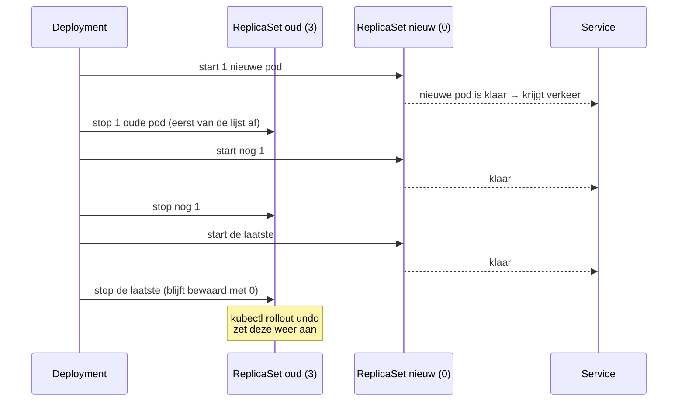

**Nieuwe versie start niet?** Dan stopt de update, en blijven de oude pods verkeer bedienen.

---

## 7. Van buiten naar binnen: de Gateway

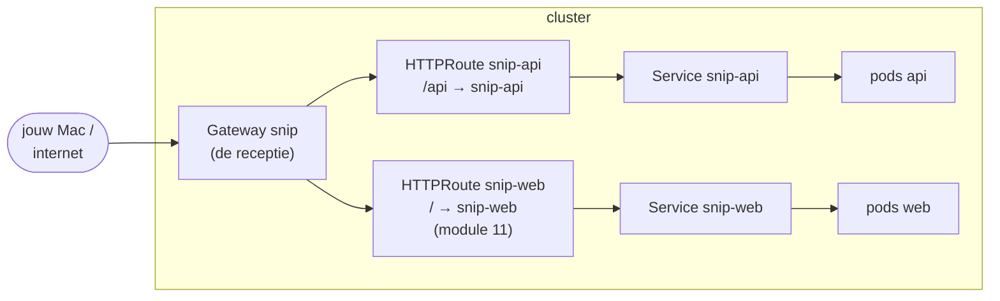

| Stuk | Wat | Op je werk van |
|---|---|---|
| **GatewayClass** | welk programma de voordeur is (bijv. Envoy) | platformteam |
| **Gateway** | de voordeur zelf: poorten, HTTPS | platformteam |
| **HTTPRoute** | de regels: welk adres naar welke Service | **jij** |
| **Ingress** | oudere manier: voordeur + regels in één object | (kom je nog tegen) |

Een Gateway of Ingress zonder programma dat hem uitvoert, doet **niets**.

---

## 8. Waar zijn adressen geldig?

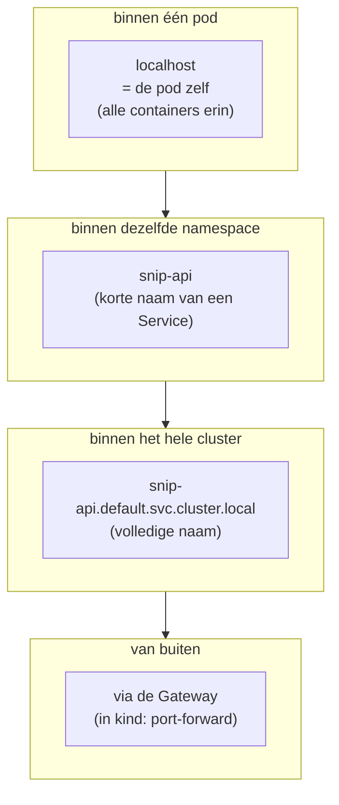

---

## 9. Wie doet wat?

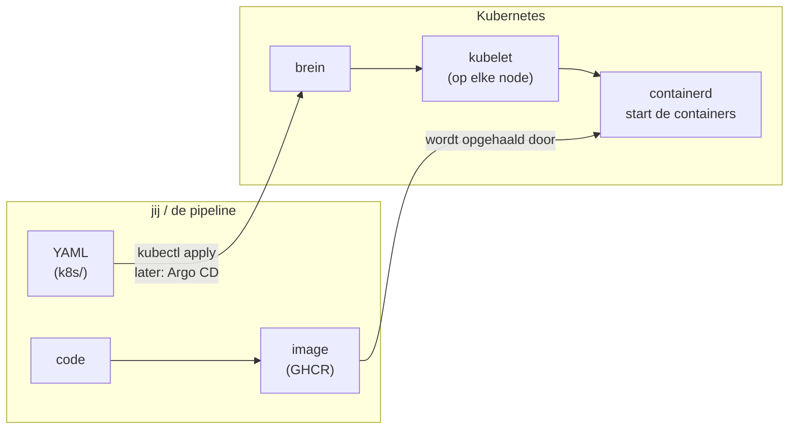

| Wie | Doet |
|---|---|
| **jij** | YAML schrijven en aanpassen |
| **pipeline** | images bouwen (later ook: nieuwe tag in Git zetten) |
| **Argo CD** (deel 3) | YAML uit Git naar het cluster brengen |
| **brein** | onthouden en beslissen |
| **kubelet** | op een node zorgen dat pods echt draaien |
| **containerd** | containers starten (geen Docker, geen Podman) |

---

## 10. Er werkt iets niet: van binnen naar buiten

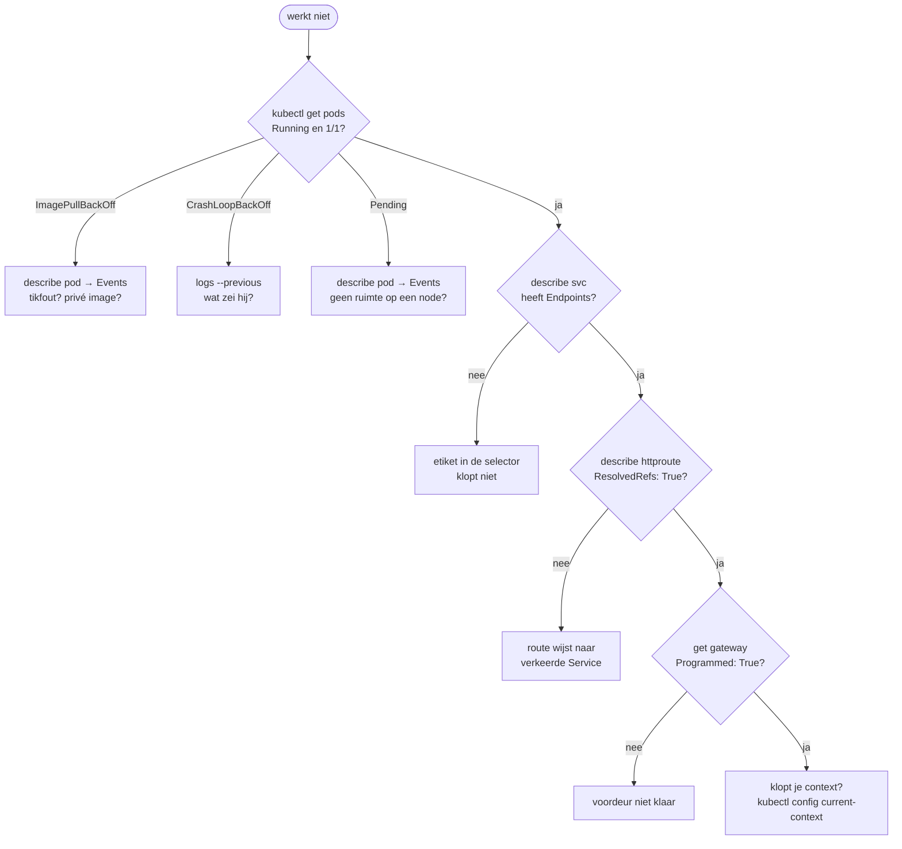
