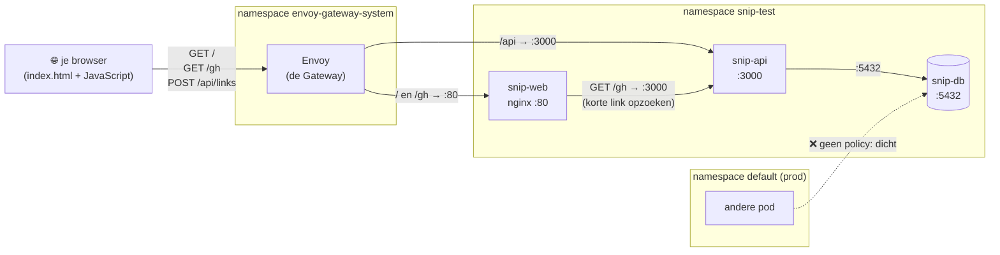

# Module 15 — Teams en grenzen

**Doel:** test en prod delen één cluster, maar zitten elkaar niet in de weg. Elk team en elke
pipeline mag alleen wat nodig is. Een namespace kan niet het hele cluster opeten. En pods praten
alleen met wie ze moeten. Tot slot zie je hetzelfde met **Cilium**, het netwerk dat je op AKS
waarschijnlijk hebt.

**Tijd:** ±2 uur (deel D: ±45 minuten extra)

**Nodig:** module 14 afgerond (snip draait in `default` en `snip-test`)

> 🖥️ **Podman Desktop:** blokjes zoals dit zijn ter controle, niet in plaats van.
> (Menunamen kunnen per versie iets verschillen.)

---

## Uitleg

### Eén cluster, meerdere teams

Je hebt nu twee omgevingen in één cluster. Kijk wat er allemaal kan:

- jij bent **admin**: je kunt alles, overal, ook prod weggooien;
- de API van test kan rechtstreeks bij de **database van prod** (en andersom);
- een fout in test (een geheugenlek, `replicas: 500`) kan het **hele cluster** volzetten.

Op je werk delen tientallen teams een cluster. Dan wil je drie dingen regelen:

| Vraag | Antwoord in Kubernetes |
|---|---|
| **Wie mag wat?** | **RBAC**: rollen en wie ze heeft |
| **Hoeveel mag je pakken?** | **ResourceQuota** en **LimitRange** per namespace |
| **Wie mag met wie praten?** | **NetworkPolicy** |

Een namespace is daarbij de eenheid: rechten, grenzen en netwerkregels gelden per namespace.

### RBAC: wie mag wat?

Drie stukjes:

```
wie                    wat                                    koppeling
─────────────────      ─────────────────────────────────      ───────────────
User / Group           Role (in één namespace)                RoleBinding
ServiceAccount         ClusterRole (overal, of herbruikbaar)  ClusterRoleBinding
```

- Een **Role** is een lijstje: "op deze dingen (`pods`, `deployments`) mag je dit doen (`get`,
  `list`, `patch`, `delete`)". Alles wat er niet staat, mag niet.
- Een **RoleBinding** geeft die rol aan iemand, in één namespace.
- Kubernetes heeft een paar kant-en-klare ClusterRoles: **`view`** (alleen kijken, geen
  Secrets), **`edit`** (alles met je app, ook Secrets) en **`admin`** (ook rechten uitdelen). Die
  `view` kende je al: die gaf je Headlamp in module 14.

**Wie** iemand is, weet Kubernetes niet zelf: er bestaan geen gebruikers in het cluster. Je
inlogmiddel (een certificaat, of op AKS een Entra ID-token) zegt wie je bent en in welke groepen
je zit. Alleen **ServiceAccounts** maakt Kubernetes zelf: dat zijn accounts voor programma's,
zoals een pipeline of Headlamp.

### Quota: hoeveel mag je pakken?

| | Geldt voor | Doet |
|---|---|---|
| **ResourceQuota** | de hele namespace samen | "samen max. 1 CPU aan requests, 10 pods". Daarboven: geweigerd |
| **LimitRange** | elke container apart | vult standaard requests en limits in als die ontbreken |

Ze horen bij elkaar. Staat er een quota op CPU, dan **moet** elke container CPU-waarden hebben,
anders weet Kubernetes niet wat hij moet optellen. De LimitRange vult die dan in.

### NetworkPolicy: wie mag met wie praten?

Standaard mag elke pod met elke andere pod praten, in alle namespaces. Een **NetworkPolicy**
kiest pods uit (op label) en zegt van wie ze verkeer aannemen. Zodra een pod door een policy
gekozen is, mag alleen nog wat er in een policy staat.

Het patroon: eerst **alles dicht** (`default-deny`), dan per pod openzetten wat nodig is. Voor
snip:



- **Doorgetrokken pijl** (binnen het cluster): een NetworkPolicy staat het toe. **Stippellijn:**
  niets staat het toe, dus dicht.
- Wat je browser doet (de pagina ophalen, een link maken met `POST /api/links`), komt altijd via
  Envoy binnen. De snip-web-pod zelf doet alleen `GET /gh` naar de API, om een korte link door te
  sturen.
- Ook extern verkeer is binnen het cluster pod-naar-pod: van Envoy naar snip-web of snip-api. Daarom
  moet Envoy in de policies staan.

Kubernetes zelf doet niets met een NetworkPolicy. Het **netwerkprogramma** van het cluster (de
**CNI**) moet ze uitvoeren. kind gebruikt *kindnet*, en dat kan het. Een CNI die het niet kan,
negeert je policies zonder foutmelding.

### Cilium

**Cilium** is zo'n netwerkprogramma, en op AKS heel gewoon ("Azure CNI powered by Cilium"). Het
voert gewone NetworkPolicies uit, maar heeft ook een eigen soort: de **CiliumNetworkPolicy**. Die
kan meer:

| | NetworkPolicy | CiliumNetworkPolicy |
|---|---|---|
| Kijkt naar | IP, poort (laag 3/4) | ook ín het verkeer (laag 7): HTTP-methode, pad, DNS-naam |
| Voorbeeld | "web mag naar api:3000" | "web mag naar api:3000, maar alleen `GET`" |
| Werkt in | elk cluster met een geschikte CNI | alleen met Cilium |

En Cilium heeft **Hubble**: je ziet live welk verkeer er is, en wat er wordt tegengehouden.

### Waar komen de woorden vandaan?

| Woord | Herkomst |
|---|---|
| **RBAC** | *Role-Based Access Control*: toegang op basis van je rol |
| **role** | Frans *rôle*: de perkamentrol met de tekst van een toneelspeler. Je rol bepaalt wat je mag zeggen en doen |
| **binding** | Engels *to bind*: vastbinden. Een rol vastmaken aan iemand |
| **quota** | Latijn *quota pars*: "het hoeveelste deel". Jouw deel van het geheel |
| **ingress / egress** | Latijn *ingredi* (binnengaan) en *egredi* (uitgaan): verkeer naar binnen en naar buiten |
| **policy** | via Frans uit Grieks *politeia*: bestuur, staatsinrichting (vergelijk *politiek*) |
| **CNI** | *Container Network Interface*: de afspraak hoe Kubernetes een netwerkprogramma aanstuurt |
| **Cilium** | Latijn *cilium*: wimper, trilhaar. Cellen hebben *cilia* om zich te bewegen en te voelen; het logo is een bij-honingraat van cellen |
| **eBPF** | *extended Berkeley Packet Filter*: kleine programma's die direct in de Linux-kernel draaien. Daar werkt Cilium mee |
| **Hubble** | naar de ruimtetelescoop (en sterrenkundige Edwin Hubble): kijken naar wat er gebeurt |
| **impersonate** (`--as`) | Latijn *in* + *persona* (masker van een toneelspeler): je voordoen als iemand anders |

---

## Lab

Je tunnels naar prod (8080) en test (8081) mogen openblijven.

```bash
cd ~/Documents/local/docker-k8s-cursus
```

### Deel A — Wie mag wat?

**1. Wie ben jij?**

```bash
kubectl auth whoami
kubectl auth can-i '*' '*'
```

Je bent een gebruiker uit het kind-certificaat, in een groep die **alles** mag (`yes` op "alles, overal").
Handig om te leren, gevaarlijk op je werk.

Om te testen wat iemand anders mag, doe je je voor als die persoon met `--as` (een gebruiker) en
`--as-group` (een groep). Er hoeft niemand te bestaan:

```bash
kubectl auth can-i get pods -n snip-test --as=jan --as-group=snip-devs
```

`no`. Jan bestaat niet echt, en niemand heeft groep `snip-devs` iets gegeven.

**2. De namespace als code**

In module 14 maakte je `snip-test` met de hand (`kubectl create namespace`). Op je werk maakt het
platformteam namespaces, mét rechten en grenzen. Dat doe jij nu ook, in `k8s/platform/`:

```bash
mkdir -p k8s/platform/namespaces
```

Maak `k8s/platform/namespaces/snip-test.yaml`, eerst alleen met de namespace:

```yaml
# De namespace snip-test, zoals het platformteam hem uitdeelt: met grenzen en rechten.
apiVersion: v1
kind: Namespace
metadata:
  name: snip-test
  labels:
    env: test
```

**3. Rechten voor het team**

Voeg onderaan toe (met `---` ertussen):

```yaml
# Het team snip-devs mag in test alles met de app doen (de ingebouwde rol edit)...
apiVersion: rbac.authorization.k8s.io/v1
kind: RoleBinding
metadata:
  name: snip-devs
  namespace: snip-test
subjects:
  - kind: Group                    # een groep, zoals op je werk een Entra ID-groep
    name: snip-devs
    apiGroup: rbac.authorization.k8s.io
roleRef:
  kind: ClusterRole                # een kant-en-klare rol...
  name: edit
  apiGroup: rbac.authorization.k8s.io
```

Een **RoleBinding** naar een **ClusterRole**: de rol `edit` bestaat overal, maar deze koppeling
geldt alleen in `snip-test`.

En in prod mag het team alleen kijken. Maak `k8s/platform/namespaces/default.yaml`:

```yaml
# Prod (namespace default): het team mag alleen kijken.
apiVersion: rbac.authorization.k8s.io/v1
kind: RoleBinding
metadata:
  name: snip-devs
  namespace: default
subjects:
  - kind: Group
    name: snip-devs
    apiGroup: rbac.authorization.k8s.io
roleRef:
  kind: ClusterRole
  name: view
  apiGroup: rbac.authorization.k8s.io
```

```bash
kubectl apply -f k8s/platform/namespaces/
```

De waarschuwing over `last-applied-configuration` mag je negeren: de namespace was met de hand
gemaakt, en kubectl neemt hem nu over.

Test als Jan:

```bash
for ns in snip-test default; do
  for actie in "get pods" "delete pods" "get secrets"; do
    echo "$ns: $actie → $(kubectl auth can-i $actie -n $ns --as=jan --as-group=snip-devs)"
  done
done
```

In test mag alles. In prod alleen kijken, en de **Secrets** (het databasewachtwoord) niet eens
zien. Dat is het verschil tussen `edit` en `view`.

**4. Een account voor de pipeline**

In module 18 rolt een pipeline nieuwe versies uit. Die hoeft niet alles te kunnen: alleen een
Deployment bijwerken. Daarvoor schrijf je je **eigen Role**. Voeg toe aan `snip-test.yaml`:

```yaml
# De pipeline: een eigen account, dat alleen Deployments mag bijwerken.
apiVersion: v1
kind: ServiceAccount
metadata:
  name: deployer
  namespace: snip-test
---
apiVersion: rbac.authorization.k8s.io/v1
kind: Role
metadata:
  name: deployer
  namespace: snip-test
rules:
  - apiGroups: ["apps"]            # Deployments horen bij de groep apps (apiVersion: apps/v1)
    resources: ["deployments"]
    verbs: ["get", "list", "watch", "patch"]
  - apiGroups: [""]                # "" = de kern (apiVersion: v1): pods, services, secrets
    resources: ["pods"]
    verbs: ["get", "list", "watch"]
---
apiVersion: rbac.authorization.k8s.io/v1
kind: RoleBinding
metadata:
  name: deployer
  namespace: snip-test
subjects:
  - kind: ServiceAccount
    name: deployer
    namespace: snip-test
roleRef:
  kind: Role
  name: deployer
  apiGroup: rbac.authorization.k8s.io
```

```bash
kubectl apply -f k8s/platform/namespaces/
```

Een ServiceAccount heet voor `--as` voluit `system:serviceaccount:NAMESPACE:NAAM`:

```bash
sa=system:serviceaccount:snip-test:deployer
kubectl -n snip-test set image deploy/snip-api api=ghcr.io/bernardus/snip-api:sha-9743b8d --as=$sa
kubectl -n snip-test delete pod snip-db-0 --as=$sa
kubectl -n snip-test get secrets --as=$sa
kubectl -n default set image deploy/snip-api api=ghcr.io/bernardus/snip-api:latest --as=$sa
```

Het bijwerken lukt. De rest: `Forbidden`. Precies genoeg om te deployen, en niets meer.

Kijk nu eens:

```bash
kubectl diff -k k8s/overlays/test
```

De image in het cluster wijkt af van Git. Iemand (de "pipeline") heeft het cluster veranderd
zonder Git. Zet het terug:

```bash
kubectl apply -k k8s/overlays/test
```

Daarom laat je in module 17 niet de pipeline in het cluster schrijven, maar in Git, en past Argo CD
het toe.

> 🖥️ **Podman Desktop:** rechten zie je hier niet. Headlamp wel: onder **Security → Roles** en
> **Role Bindings**.

### Deel B — Hoeveel mag je pakken?

**5. Quota en standaardwaarden**

Voeg aan `snip-test.yaml` toe:

```yaml
# Hoeveel mag de hele namespace samen gebruiken?
apiVersion: v1
kind: ResourceQuota
metadata:
  name: snip-test
  namespace: snip-test
spec:
  hard:
    requests.cpu: "1"              # samen max. 1 processorkern gereserveerd
    requests.memory: 1Gi
    limits.cpu: "4"
    limits.memory: 2Gi
    pods: "10"
---
# Standaardwaarden voor containers die zelf niets opgeven.
apiVersion: v1
kind: LimitRange
metadata:
  name: snip-test
  namespace: snip-test
spec:
  limits:
    - type: Container
      defaultRequest:              # geen requests? dan deze
        cpu: 50m
        memory: 64Mi
      default:                     # geen limits? dan deze
        cpu: 500m
        memory: 256Mi
```

```bash
kubectl apply -f k8s/platform/namespaces/
kubectl describe quota -n snip-test
```

Je ziet per regel hoeveel er gebruikt is en wat het maximum is.

**6. De proef**

De website heeft in module 13 geen CPU-limit gekregen. Start hem opnieuw en kijk wat hij nu
krijgt:

```bash
kubectl -n snip-test rollout restart deploy/snip-web
kubectl -n snip-test rollout status deploy/snip-web
kubectl -n snip-test get pods -l app=snip-web -o jsonpath='{.items[*].spec.containers[0].resources}'
```

`limits.cpu: 500m`: ingevuld door de LimitRange. Nu te veel vragen:

```bash
kubectl -n snip-test scale deploy/snip-web --replicas=20
kubectl -n snip-test get deploy snip-web
kubectl -n snip-test get events --field-selector reason=FailedCreate | tail -2
```

Ongeveer 7 van de 20. `exceeded quota: ... limits.cpu`. Elke website-pod gebruikt maar een paar
millicores, maar telt mee met de **500m** van de standaardlimit. Een standaardwaarde is dus niet
gratis: zet liever zelf eerlijke waarden.

```bash
kubectl apply -k k8s/overlays/test
```

Terug naar 1 pod, zoals Git zegt.

### Deel C — Wie mag met wie praten?

**7. Eerst kijken: alles staat open**

Start een tijdelijke pod in **prod**, en klop aan bij de database van **test**:

```bash
kubectl run indringer --image=postgres:18-alpine --restart=Never --rm -it -- \
  pg_isready -h snip-db.snip-test -t 3
```

`accepting connections`. Elke pod in het cluster kan bij elke database. Met het wachtwoord erbij
is dat een groot lek.

**8. Dicht, en dan open wat nodig is**

Wie met wie praat, hoort bij de app: in test en prod hetzelfde. Daarom komt het in de **base**.
Maak `k8s/base/networkpolicy.yaml`:

```yaml
# Wie mag met wie praten? Eerst: niemand. Daarna alleen wat snip nodig heeft.
apiVersion: networking.k8s.io/v1
kind: NetworkPolicy
metadata:
  name: default-deny
spec:
  podSelector: {}                  # alle pods in deze namespace...
  policyTypes: [Ingress]           # ...nemen geen binnenkomend verkeer aan
```

Dan de uitzonderingen, met `---` ertussen. De voordeur mag naar de website:

```yaml
# De voordeur (Envoy) mag naar de website.
apiVersion: networking.k8s.io/v1
kind: NetworkPolicy
metadata:
  name: snip-web
spec:
  podSelector:                     # voor welke pods geldt dit?
    matchLabels:
      app: snip-web
  ingress:
    - from:                        # van wie mag het komen?
        - namespaceSelector:
            matchLabels:
              kubernetes.io/metadata.name: envoy-gateway-system
      ports:
        - port: 80
```

Elke namespace heeft vanzelf het label `kubernetes.io/metadata.name` met zijn eigen naam. Zo wijs
je een andere namespace aan.

De API: van de voordeur (`/api`) én van de website (korte links zoals `/gh`, via nginx):

```yaml
# De API: van de voordeur (/api) en van de website (korte links).
apiVersion: networking.k8s.io/v1
kind: NetworkPolicy
metadata:
  name: snip-api
spec:
  podSelector:
    matchLabels:
      app: snip-api
  ingress:
    - from:                        # twee streepjes = of de een, of de ander
        - namespaceSelector:
            matchLabels:
              kubernetes.io/metadata.name: envoy-gateway-system
        - podSelector:             # zonder namespaceSelector: uit dezelfde namespace
            matchLabels:
              app: snip-web
      ports:
        - port: 3000               # de poort van de pod, niet van de Service
```

De database: alleen de API, uit dezelfde namespace:

```yaml
# De database: alleen de API, uit dezelfde namespace.
apiVersion: networking.k8s.io/v1
kind: NetworkPolicy
metadata:
  name: snip-db
spec:
  podSelector:
    matchLabels:
      app: snip-db
  ingress:
    - from:
        - podSelector:
            matchLabels:
              app: snip-api
      ports:
        - port: 5432
```

Zet het bestand in `k8s/base/kustomization.yaml`, onder `gateway.yaml`:

```yaml
resources:
  - gateway.yaml
  - networkpolicy.yaml
  ...
```

Bekijk wat er verandert, en rol beide omgevingen uit:

```bash
kubectl diff -k k8s/overlays/prod
kubectl apply -k k8s/overlays/prod
kubectl apply -k k8s/overlays/test
kubectl get networkpolicy -A
```

Vier policies per namespace. Nu de proef:

```bash
kubectl run indringer --image=postgres:18-alpine --restart=Never --rm -it -- \
  pg_isready -h snip-db.snip-test -t 3
```

`no response`. En snip zelf? Ververs <http://localhost:8080> en <http://localhost:8081>, maak een
link aan, en probeer <http://localhost:8080/gh>. Alles werkt nog.

Waarom blijven de probes werken? Die komen van de **kubelet** op de node zelf, en dat verkeer laat
de CNI altijd door.

> 🖥️ **Podman Desktop:** NetworkPolicies zie je niet. In Headlamp staan ze onder **Network →
> Network Policies**.

### Deel D — Cilium (optioneel, eigen cluster)

Om Cilium te gebruiken moet het netwerk van een cluster vanaf het begin anders. Je `snip`-cluster
laat je dus met rust, en je maakt een tweede.

**9. Een cluster zonder netwerk**

```bash
kind create cluster --name cilium --config modules/15-teams-en-grenzen/cilium/kind-cilium.yaml
kubectl get nodes
```

`disableDefaultCNI: true`: geen kindnet. De node is `NotReady` en de pods van `coredns` blijven
hangen: er is geen netwerk.

kind zet je actieve context vanzelf op het nieuwe cluster (`kind-cilium`). Alles in deel D gaat
daarheen. Aan het eind zet je hem terug.

**10. Cilium installeren**

Met Helm, net als Headlamp:

```bash
helm repo add cilium https://helm.cilium.io/
helm install cilium cilium/cilium --version 1.20.4 --namespace kube-system \
  --set ipam.mode=kubernetes \
  --set operator.replicas=1 \
  --set hubble.relay.enabled=true \
  --set hubble.ui.enabled=true
kubectl -n kube-system rollout status ds/cilium
kubectl get nodes
```

`Ready`. (`operator.replicas=1`: standaard wil Cilium er twee, op twee verschillende nodes; je
hebt er één.)

Hier gebruik je wel `--set`: het is een wegwerpcluster. Voor een echt cluster zet je dit in een
values-bestand.

**11. snip erin**

Er is hier geen Envoy Gateway, dus de Gateway en HTTPRoutes laat je weg. Daarvoor staat er een
kustomization klaar in de module, die je base gebruikt:

```bash
cat modules/15-teams-en-grenzen/cilium/kustomization.yaml
```

`$patch: delete` is een patch die iets weghaalt in plaats van aanpast.

```bash
kubectl create namespace snip
kubectl -n snip create secret generic snip-db --from-literal=password=$(openssl rand -hex 16)
kubectl apply -k modules/15-teams-en-grenzen/cilium
kubectl get pods -n snip --watch
```

Alles komt `1/1`: je **gewone NetworkPolicies uit deel C werken ook met Cilium**. `Ctrl+C`.

Kijk mee met Hubble. Open een tweede terminal:

```bash
kubectl -n kube-system exec ds/cilium -c cilium-agent -- hubble observe --namespace snip --follow
```

En klop in de eerste terminal aan bij de API, zonder het label van de website:

```bash
kubectl -n snip run indringer --image=curlimages/curl:8.17.0 --restart=Never --rm -it -- \
  curl -s -m 3 snip-api/api/links
```

In Hubble: `Policy denied DROPPED`. Je ziet precies wie, naar wie, en waarom.

**12. Alleen lezen (laag 7)**

Doe je nu voor als de website (`-l app=snip-web`). Lezen en schrijven gaan allebei:

```bash
kubectl -n snip run web -l app=snip-web --image=curlimages/curl:8.17.0 --restart=Never --rm -it -- sh
```

In die pod:

```sh
curl -s -o /dev/null -w "GET %{http_code}\n" snip-api/api/links
curl -s -o /dev/null -w "POST %{http_code}\n" -H content-type:application/json \
  -d '{"url":"https://example.com"}' snip-api/api/links
```

`200` en `201`. Maar de website hoeft nooit iets toe te voegen: alleen korte links opzoeken. Laat
deze pod open, en maak in de andere terminal `modules/15-teams-en-grenzen/cilium/l7-policy.yaml`:

```yaml
# Cilium kijkt ook ín het verkeer: de website mag de API alleen iets vrágen (GET), niets toevoegen.
apiVersion: cilium.io/v2
kind: CiliumNetworkPolicy
metadata:
  name: snip-api-alleen-lezen
spec:
  endpointSelector:                # voor welke pods (zoals podSelector)
    matchLabels:
      app: snip-api
  ingress:
    - fromEndpoints:               # van wie (zoals from.podSelector)
        - matchLabels:
            app: snip-web
      toPorts:
        - ports:
            - port: "3000"
              protocol: TCP
          rules:
            http:                  # laag 7: alleen deze HTTP-verzoeken
              - method: GET
```

```bash
kubectl -n snip apply -f modules/15-teams-en-grenzen/cilium/l7-policy.yaml
```

Probeer in de web-pod de `POST` nog eens. `201`, het werkt nog steeds!

Policies **tellen op**: wat in één policy mag, mag. De gewone NetworkPolicy `snip-api` uit deel C
laat de website op poort 3000 toe, met álle verzoeken. Gooi die hier weg:

```bash
kubectl -n snip delete networkpolicy snip-api
```

En nog eens in de web-pod: `GET 200`, `POST 403`. Hubble laat het zien: `http-request DROPPED
(HTTP/1.1 POST ...)`. Typ `exit` in de web-pod.

Wil je het ook als plaatje: Hubble heeft een website.

```bash
kubectl -n kube-system port-forward svc/hubble-ui 12000:80
```

Open <http://localhost:12000> en kies namespace `snip`.

**13. Opruimen**

```bash
kind delete cluster --name cilium
kubectl config use-context kind-snip
```

---

## Breek het

### 💥 1. Een tikfout in een label

```bash
kubectl -n snip-test patch networkpolicy snip-db --type=json \
  -p '[{"op":"replace","path":"/spec/ingress/0/from/0/podSelector/matchLabels/app","value":"snip-apii"}]'
kubectl -n snip-test rollout restart deploy/snip-api
kubectl -n snip-test get pods --watch
```

Wat zie je, en wat zie je op <http://localhost:8081>?

<details>
<summary>Uitleg</summary>

De nieuwe API-pod komt niet op `1/1`: zijn readiness probe (`/health/db`) kan de database niet
bereiken. De policy staat de database open voor pods met label `snip-apii`, en die bestaan niet.

De oude API-pod blijft draaien (`maxUnavailable: 0` uit module 09), dus de site werkt nog. Die
had zijn verbinding al. Een NetworkPolicy breekt vooral **nieuwe** verbindingen.

Een NetworkPolicy geeft nooit een foutmelding: een verkeerd label kiest gewoon niemand. Herstel
vanuit Git:

```bash
kubectl apply -k k8s/overlays/test
```
</details>

### 💥 2. Ook naar buiten dicht

`default-deny` gaat over verkeer naar binnen. Wat als je ook verkeer naar buiten dichtzet?

```bash
cat <<'EOF' | kubectl -n snip-test apply -f -
apiVersion: networking.k8s.io/v1
kind: NetworkPolicy
metadata:
  name: niets-naar-buiten
spec:
  podSelector: {}
  policyTypes: [Egress]
EOF
kubectl -n snip-test rollout restart deploy/snip-api
kubectl -n snip-test get pods --watch
```

<details>
<summary>Uitleg</summary>

De nieuwe API-pod komt niet op `1/1`, en wordt na een tijdje herstart. Hij mag nu helemaal niets
meer naar buiten: niet naar de database, en ook niet naar **DNS** in `kube-system`. Hij kan de
naam `snip-db` niet eens opzoeken.

Wie egress dichtzet, moet altijd DNS openzetten (poort 53, UDP en TCP, naar de pods met
`k8s-app: kube-dns`), plus elk adres dat de app nodig heeft. Daarom begin je meestal met alleen
ingress.

```bash
kubectl -n snip-test delete networkpolicy niets-naar-buiten
```
</details>

### 💥 3. Een vergeten namespace

Een collega wil het team ook `edit` geven op een nieuwe namespace, en maakt dit bestand:

```bash
cat > /tmp/rechten.yaml <<'EOF'
apiVersion: rbac.authorization.k8s.io/v1
kind: RoleBinding
metadata:
  name: snip-devs-edit
subjects:
  - kind: Group
    name: snip-devs
    apiGroup: rbac.authorization.k8s.io
roleRef:
  kind: ClusterRole
  name: edit
  apiGroup: rbac.authorization.k8s.io
EOF
kubectl apply -f /tmp/rechten.yaml
kubectl auth can-i delete pods -n default --as=jan --as-group=snip-devs
```

<details>
<summary>Uitleg</summary>

`yes`. Het team mag nu pods weggooien in **prod**. Er staat geen `namespace:` in het bestand, dus
kubectl gebruikte je huidige namespace: `default`.

Zet bij RBAC-bestanden altijd de namespace erin. En controleer met `kubectl auth can-i` wat iemand
echt mag: rechten tellen op, net als policies.

```bash
kubectl delete -f /tmp/rechten.yaml
```
</details>

---

## Op je werk

- **Je bent geen admin.** Je komt binnen met je Entra ID-account (via `kubelogin`). Je rechten
  komen uit RoleBindings op **Entra ID-groepen**, net als `snip-devs` hier; in het bestand staat
  dan de object-ID van de groep. Kijk wat je mag:

  ```bash
  kubectl auth can-i --list -n <jullie-namespace>
  ```

- **Namespaces komen van het platformteam,** met quota, LimitRange en RoleBindings erbij, precies
  zoals je `k8s/platform/namespaces/`. Daarom staat in jullie Argo CD Application
  `CreateNamespace=false`: de namespace bestaat al, en Argo CD mag hem niet zelf maken.
- **Argo CD** heeft zelf een ServiceAccount met veel rechten. Wat jullie team via Argo mag, regelt
  een **AppProject**: welke repo's, welke namespaces, welke soorten objecten. Module 23.
- **Je pods** krijgen ook een ServiceAccount. Op AKS koppel je die aan een Azure-identiteit
  (*Workload Identity*), zodat je app zonder wachtwoord bij Key Vault of een database kan. Module 21.
- **NetworkPolicies** zitten vaak in de chart van het platformteam: een `default-deny` voor elke
  namespace, en jij zet in je values wat er open moet. Kijk wat er bij jullie staat:

  ```bash
  kubectl get networkpolicy,ciliumnetworkpolicy -n <jullie-namespace>
  ```

- **Cilium op AKS:** "Azure CNI powered by Cilium" voert gewone NetworkPolicies uit. Laag 7- en
  DNS-regels (zoals "alleen `GET`" of "alleen naar `*.azure.com`") en Hubble zitten bij AKS in een
  extra pakket (*Advanced Container Networking Services*). Of jullie dat hebben, weet het
  platformteam.
- **Quota merk je pas als het misgaat:** een deploy blijft hangen op een paar pods, met
  `exceeded quota` in de events (`kubectl get events`). Vraag dan meer quota aan, of verlaag je
  requests.

---

## Checkpoint

<details>
<summary>1. Wat is het verschil tussen een Role en een RoleBinding?</summary>

Een Role zegt **wat** mag (welke acties op welke soorten objecten). Een RoleBinding zegt **wie**
die rol krijgt, in welke namespace.
</details>

<details>
<summary>2. Waarom kun je met een RoleBinding naar een ClusterRole verwijzen?</summary>

Een ClusterRole zoals `edit` bestaat één keer voor het hele cluster. Met een RoleBinding geef je
hem aan iemand **in één namespace**. Zo hoef je niet in elke namespace dezelfde Role te schrijven.
</details>

<details>
<summary>3. Wat is het verschil tussen <code>view</code> en <code>edit</code>?</summary>

`view` mag alleen kijken, en kan Secrets niet lezen. `edit` mag alles met de app aanpassen, ook
Secrets lezen. Alleen `admin` mag ook rechten uitdelen.
</details>

<details>
<summary>4. Waarom heb je een LimitRange nodig naast een ResourceQuota?</summary>

Staat er een quota op CPU of geheugen, dan moet elke container daar waarden voor hebben. Zonder
wordt de pod geweigerd. De LimitRange vult standaardwaarden in voor containers die niets opgeven.
</details>

<details>
<summary>5. Je zet <code>default-deny</code> in een namespace. Waarom werken de probes nog?</summary>

Probes komen van de kubelet op de node zelf. Dat verkeer laat de CNI altijd door.
</details>

<details>
<summary>6. Je CiliumNetworkPolicy staat alleen <code>GET</code> toe, maar <code>POST</code> lukt nog. Hoe kan dat?</summary>

Policies tellen op. Een andere policy (zoals een gewone NetworkPolicy) staat dezelfde poort helemaal
toe, en die wint.
</details>

<details>
<summary>7. Waarom staan de NetworkPolicies in <code>k8s/base/</code>, en de quota en rechten in <code>k8s/platform/</code>?</summary>

Met wie snip praat, hoort bij de app en is in elke omgeving hetzelfde. Rechten en quota horen bij
de namespace, en die regelt het platformteam.
</details>

### Eindopdracht

Zorg dat:
1. `k8s/platform/namespaces/snip-test.yaml` de namespace, de quota, de LimitRange, de rechten voor
   `snip-devs` en het account `deployer` bevat, en `default.yaml` het team in prod alleen `view`
   geeft;
2. `k8s/base/networkpolicy.yaml` in de base staat, en prod en test ermee zijn uitgerold;
3. prod niet meer bij de database van test kan, en snip in beide omgevingen nog gewoon werkt;
4. (optioneel) deel D: laat je cluster `cilium` dan nog even staan tot `check.sh` groen is.

```bash
cd ~/Documents/local/docker-k8s-cursus/modules/15-teams-en-grenzen
./check.sh
```

Groen? Je cluster heeft nu muren tussen de omgevingen. In **module 16** ga je debuggen: wat doe je
als een pod niet start, en hoe vind je snel waarom?

---

## Spiekbrief

| Commando | Wat het doet |
|---|---|
| `kubectl auth whoami` | wie ben ik? |
| `kubectl auth can-i ACTIE SOORT -n NS` | mag ik dit? |
| `... --as=NAAM --as-group=GROEP` | mag iemand anders dit? |
| `--as=system:serviceaccount:NS:NAAM` | mag dit ServiceAccount dit? |
| `kubectl auth can-i --list -n NS` | alles wat ik mag |
| `kubectl describe quota -n NS` | gebruik en maximum |
| `kubectl get networkpolicy -A` | alle policies |
| `kubectl get events --field-selector reason=FailedCreate` | o.a. `exceeded quota` |
| `hubble observe --namespace NS --follow` | live verkeer (in de cilium-pod) |

| YAML | |
|---|---|
| `Role` / `ClusterRole` | wat mag (`apiGroups`, `resources`, `verbs`) |
| `RoleBinding` / `ClusterRoleBinding` | wie (`subjects`) krijgt welke rol (`roleRef`) |
| `ServiceAccount` | een account voor een programma |
| `ResourceQuota` | maximum voor de hele namespace |
| `LimitRange` | standaard requests en limits per container |
| `NetworkPolicy` | `podSelector` (voor wie) + `ingress.from` (van wie) + `ports` |
| `CiliumNetworkPolicy` | hetzelfde, plus `rules.http` (laag 7) |
