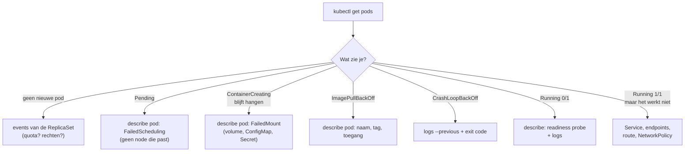

# Module 16 — Debuggen als een pro

**Doel:** als iets niet werkt, weet je in welke volgorde je kijkt. Je herkent de klassieke fouten
aan hun status, je kijkt in een pod zonder shell, en je werkt met **k9s**. Daarna los je zes
storingen op zonder te weten wat er kapot is.

**Tijd:** ±2,5 uur

**Nodig:** module 15 afgerond (snip-test met quota en NetworkPolicies)

> 🖥️ **Podman Desktop:** blokjes zoals dit zijn ter controle, niet in plaats van.
> (Menunamen kunnen per versie iets verschillen.)

---

## Uitleg

### Van buiten naar binnen

Je hebt al veel fouten gezien: een tikfout in een image (module 08), een vergeten Secret (11), te
weinig geheugen (13). Elke keer wist je wat er kapot was. Op je werk weet je dat niet. Dan krijg je
een melding als "de site doet raar", en moet je zelf zoeken.

Daarom werk je altijd in dezelfde volgorde, van buiten naar binnen:

| Stap | Commando | Vraag |
|---|---|---|
| 1 | `kubectl get` | Wat is de **status**? Draait alles, en is het klaar (`1/1`)? |
| 2 | `kubectl describe` en `kubectl events` | Wat zegt **Kubernetes**? (de Events onderaan) |
| 3 | `kubectl logs` | Wat zegt de **app**? |
| 4 | `kubectl exec` / `kubectl debug` | Wat zie je **in** de pod? |
| 5 | Service → endpoints → pod | Komt het **verkeer** aan? |
| 6 | `kubectl diff -k` | Wat is er anders dan in **Git**? |

Kubernetes vertelt je bijna altijd wat er mis is. Je moet alleen op de goede plek kijken. De
status van de pod (stap 1) zegt je waar:



### De klassiekers

| Status | Wat er aan de hand is | Waar je kijkt |
|---|---|---|
| *(geen pod)* | De ReplicaSet **mag** de pod niet maken, bijvoorbeeld door de quota | `kubectl events`, `describe rs` |
| `Pending` | De scheduler vindt geen node die past (te weinig CPU, verkeerde `nodeSelector`) | `describe pod`: `FailedScheduling` |
| `ContainerCreating` | Een volume, ConfigMap of Secret voor een volume ontbreekt | `describe pod`: `FailedMount` |
| `ErrImagePull` / `ImagePullBackOff` | Image of tag bestaat niet, of je hebt geen toegang | `describe pod` |
| `CreateContainerConfigError` | Een Secret of ConfigMap voor een `env` ontbreekt | `describe pod` |
| `CrashLoopBackOff` | De container start en stopt meteen, steeds opnieuw | `logs --previous`, exit code |
| `OOMKilled` | Meer geheugen dan de limit | `describe pod`: `Last State` |
| `Running` `0/1` | De container draait, maar de readiness probe faalt | `describe pod`, `logs` |
| `Running` `1/1` | Alles lijkt goed, maar het verkeer komt niet aan | endpoints, `port-forward`, policies |

**Back-off** betekent: Kubernetes probeert het opnieuw, maar wacht steeds langer (10 s, 20 s,
40 s… tot 5 minuten). Daarom duurt het na een reparatie soms even voor je iets ziet.

### Exit codes

Stopt een container, dan geeft hij een getal terug. Dat zie je bij `Last State` in `describe pod`:

| Code | Betekenis |
|---|---|
| `0` | klaar, zonder fouten (bij een webserver toch raar: die hoort niet te stoppen) |
| `1` | de app zelf gaf een fout (kijk in de logs) |
| `126` / `127` | het commando mag niet draaien / bestaat niet |
| `137` | gestopt met `SIGKILL` (128 + 9): meestal **OOMKilled** |
| `143` | gestopt met `SIGTERM` (128 + 15): netjes gestopt, bijvoorbeeld bij een rollout |

Boven de 128? Dan is het 128 + het nummer van het signaal dat de container stopte.

### Events: het logboek van Kubernetes

Alles wat Kubernetes doet of niet kan, schrijft het op als **event**: "pod ingepland",
"image opgehaald", "probe mislukt", "quota overschreden". Je ziet ze onderaan `describe`, of
allemaal met `kubectl events`.

Twee dingen om te weten:

- events blijven maar **een uur** bewaard;
- een event hoort bij het object dat het probleem **heeft**. Mag een pod niet gemaakt worden, dan
  staat het event bij de **ReplicaSet** (er is geen pod). Kijk je alleen naar pods, dan zie je
  niets.

### Kijken in een pod zonder gereedschap

Met `kubectl exec` draai je een commando in een container. Maar de API draait op `node:24-slim`:
daar zit geen `curl`, `ps` of `nslookup` in. Sommige images hebben zelfs geen shell
(*distroless*). Dat is goed voor de veiligheid, maar lastig bij zoeken.

Daarvoor is `kubectl debug`. Die zet een **tijdelijke container** (*ephemeral container*) in een
draaiende pod, met een image dat jij kiest, bijvoorbeeld `busybox` vol gereedschap:

```
┌──────── pod snip-api-… ─────────────────────────┐
│  container api        container debugger-xyz    │
│  (node, geen tools)   (busybox: wget, nslookup) │
│                                                 │
│  ─── zelfde netwerk: localhost:3000 ─────────── │
│  ─── met --target=api: zelfde processen ─────── │
└─────────────────────────────────────────────────┘
```

De debug-container deelt het netwerk van de pod: `localhost:3000` is de API. Met `--target=api`
ziet hij ook de processen van de API. Een tijdelijke container kun je niet weghalen: hij verdwijnt
pas met de pod.

### k9s

Headlamp (module 14) is een website. **k9s** is hetzelfde idee in je terminal: een scherm dat
zichzelf bijwerkt, waarin je met toetsen door je cluster loopt. Logs, describe, een shell, alles
met één toets. Handig als je snel moet zoeken.

Maar: k9s doet niets wat `kubectl` niet kan. En bij het CKAD-examen heb je alleen `kubectl`. Leer
dus eerst de commando's, en gebruik k9s om sneller te zijn.

### Waar komen de woorden vandaan?

| Woord | Herkomst |
|---|---|
| **debug** | Engels *bug*: insect. Al in de 19e eeuw een woord voor een fout in een machine. Beroemd: in 1947 vond het team van Grace Hopper een echte mot in een computer, en plakte die in het logboek |
| **log** | Engels *log*: boomstam. Zeelui gooiden een stuk hout aan een touw overboord om de snelheid te meten, en schreven die op in het *logbook*. Nu: alles wat een programma opschrijft |
| **event** | Latijn *evenire*: uitkomen, gebeuren |
| **triage** | Frans *trier*: sorteren. Op de eerste hulp eerst kijken wat het ergst is. Zo werk je hier ook: eerst de status, dan pas details |
| **crash loop** | *crash*: neerstorten; *loop*: lus. Starten, crashen, starten, crashen… |
| **back-off** | Engels *to back off*: terugdeinzen. Even wachten voor je het opnieuw probeert |
| **pending** | Latijn *pendere*: hangen. De pod hangt nog: hij heeft geen plek |
| **scheduler** | Latijn *schedula*: strookje papier, een lijstje. De scheduler maakt het rooster: welke pod op welke node |
| **exit code** | Latijn *exire*: naar buiten gaan. Het getal waarmee een programma vertrekt |
| **signal** (`SIGKILL`, `SIGTERM`) | Latijn *signum*: teken. Een seintje van het besturingssysteem aan een programma: *terminate* (stop netjes) of *kill* (stop nu) |
| **OOM** | *Out Of Memory*: geheugen op |
| **ephemeral** | Grieks *ephēmeros*: wat maar één dag duurt (vergelijk *eendagsvlieg*). Een container die er maar even is |
| **distroless** | *distro* (distributie, zoals Debian) + *less*: zonder. Een image met alleen je app, zonder de rest van Linux |
| **k9s** | *canines*: honden. Net als `k8s` (k + 8 letters + s) een woordgrap; het logo is een hond die voor je speurt |

---

## Lab

```bash
cd ~/Documents/local/docker-k8s-cursus
kubectl config current-context        # kind-snip
```

Alles in dit lab gebeurt in **snip-test**. Prod blijft met rust.

### Deel A — Je gereedschap

Eerst oefen je op een gezonde app. Dan weet je hoe "goed" eruitziet.

**1. De status**

```bash
kubectl get pods -n snip-test -o wide
kubectl get all -n snip-test
```

`-o wide` laat ook het IP-adres en de node zien. `get all` toont pods, Services, Deployments en
ReplicaSets (niet alles, ondanks de naam: geen ConfigMaps, Secrets of policies).

Wil je één veld? Gebruik `jsonpath`:

```bash
kubectl get pods -n snip-test -o jsonpath='{range .items[*]}{.metadata.name}{"  "}{.status.containerStatuses[0].restartCount}{"\n"}{end}'
```

Dat zijn de herstarts per pod. Gaat dat getal omhoog, dan is er iets.

> 💡 Steeds `-n snip-test` typen is foutgevoelig. Je kunt de namespace ook vastzetten:
> `kubectl config set-context --current --namespace=snip-test`. Dan moet je wél onthouden dat je
> dat gedaan hebt (zie Breek het 2). In dit lab typen we hem steeds.

**2. Wat zegt Kubernetes?**

```bash
kubectl describe pod -n snip-test -l app=snip-api
kubectl events -n snip-test
kubectl events -n snip-test --types=Warning
```

Bij `describe` staat het belangrijkste **onderaan**: de Events. Bij een gezonde pod zie je
`Scheduled`, `Pulled`, `Created`, `Started`. Kijk ook naar `State`, `Last State` en `Restart Count`
bovenaan.

`kubectl events` toont alles in de namespace, op tijd. Met `--for` kijk je naar één object:

```bash
kubectl events -n snip-test --for deployment/snip-api
```

**3. Wat zegt de app?**

```bash
kubectl logs -n snip-test deploy/snip-api
kubectl logs -n snip-test -l app=snip-web --prefix --tail=5
kubectl logs -n snip-test deploy/snip-api -f --since=1m
```

- `deploy/snip-api` kiest zelf een pod van die Deployment;
- `-l` met `--prefix` toont meerdere pods tegelijk, met de podnaam ervoor;
- `-f` volgt live (stop met Ctrl-C), `--since` en `--tail` beperken hoeveel je ziet.

Open <http://localhost:8081> en maak een korte link terwijl `-f` loopt. (Zie je niets? De API logt
alleen fouten.) Herstart een container, dan staan de logs van de **vorige** keer onder `--previous`.

**4. Kijken in de pod**

```bash
kubectl exec -n snip-test deploy/snip-api -- curl -s localhost:3000/health
```

```
error: ... exec: "curl": executable file not found in $PATH
```

Het image heeft geen curl. Zet er een debug-container naast:

```bash
pod=$(kubectl get pod -n snip-test -l app=snip-api -o name | head -1)
kubectl debug -n snip-test -it $pod --image=busybox:1.37 --target=api -- sh
```

Je zit nu in busybox, **in de pod** van de API. (Geen prompt? Druk op Enter.) Probeer:

```sh
wget -qO- localhost:3000/health                # de API, via het gedeelde netwerk
nslookup snip-db.snip-test.svc.cluster.local   # werkt de naam van de database?
ps                                             # met --target zie je het node-proces van de API
exit
```

De debug-container blijft in de pod staan (gestopt):

```bash
kubectl get $pod -n snip-test -o jsonpath='{.spec.ephemeralContainers[*].name}'; echo
```

Hij verdwijnt pas als de pod weg is.

**5. Het verkeer**

Werkt een pod wel, maar komt er niets aan? Volg dan de weg: route → Service → endpoints → pod.

```bash
kubectl get endpointslices -n snip-test -l kubernetes.io/service-name=snip-api
```

Hier staan de IP-adressen en de **poort** van de pods achter de Service. Leeg? Dan past de
`selector` op geen enkele pod die klaar is.

Test daarna elke stap apart, in een tweede terminal:

```bash
kubectl port-forward -n snip-test $pod 9001:3000        # rechtstreeks naar de pod
kubectl port-forward -n snip-test svc/snip-api 9002:80  # via de Service
```

```bash
curl -s localhost:9001/api/info
curl -s localhost:9002/api/info
```

Werkt de pod wel en de Service niet? Dan zit de fout in de Service. Werkt allebei, maar de site
niet? Dan zit het daarvoor: de route, de Gateway, of een NetworkPolicy. Stop de tunnels met Ctrl-C.

**6. Vergelijken met Git**

```bash
kubectl diff -k k8s/overlays/test
```

Leeg? Dan is het cluster gelijk aan Git. Dit is vaak de snelste weg naar "wat is er veranderd".
Maar `diff` ziet alleen objecten die **in Git staan**. Een object dat iemand met de hand heeft
toegevoegd, zie je niet. En het zegt niet wát er misgaat, alleen wat er anders is.

> 🖥️ **Podman Desktop / Headlamp:** in Headlamp zie je bij een pod dezelfde Events, de logs en
> een knop voor een terminal. Kijk gerust mee.

### Deel B — k9s

**7. Installeren en starten**

```bash
brew install k9s
k9s -n snip-test
```

Bovenaan staan je **context** en het cluster. Kijk daar altijd eerst: zit je in het goede cluster?

**8. Rondlopen**

| Toets | Wat het doet |
|---|---|
| `:pods` ⏎ | naar de pods (ook `:deploy`, `:svc`, `:events`, `:netpol`, `:quota`…) |
| `/` | filteren, bijvoorbeeld `/api` |
| `0` | alle namespaces (`1` terug naar snip-test) |
| ⏎ | inzoomen (Deployment → pods → containers) |
| `d` | describe |
| `l` | logs (`0` voor alles, `p` voor `--previous`) |
| `s` | shell in de container |
| `y` | de YAML |
| `Esc` | terug |
| `?` | alle toetsen |
| `Ctrl-d` | **weggooien** (vraagt nog wel om bevestiging) |
| `:q` | stoppen |

Probeer: ga naar de pods van snip-test, bekijk de logs van snip-web, en de describe van de
database. Ga naar `:events`. Ga naar `:deploy` en zoom in op snip-api.

**9. Alleen kijken**

```bash
k9s -n snip-test --readonly
```

Nu kan k9s niets weggooien of aanpassen. Gebruik dit op prod, zodat een verkeerde toets geen
storing wordt.

### Deel C — Storingen

Nu het echte werk. Het script `storing.sh` maakt iets kapot in snip-test. Wat precies, staat
**niet** in de README. Je krijgt alleen een melding, zoals op je werk.

Spelregels:

1. Niet spieken in `storing.sh`.
2. Gebruik eerst stap 1 t/m 5. `kubectl diff` mag pas als je een vermoeden hebt, om het te
   bevestigen.
3. Schrijf per storing op: wat zag je, wat is de oorzaak, met welk commando vond je het?
4. Herstel **vanuit Git**, niet met de hand:

   ```bash
   kubectl apply -k k8s/overlays/test                         # de app
   kubectl apply -f k8s/platform/namespaces/snip-test.yaml    # de namespace (quota, rechten)
   ```

5. Is alles weer `1/1` en werkt <http://localhost:8081>? Dan de volgende.

> ⚠️ Heb je module 17 (Argo CD) al gedaan? Dan zet self-heal elke storing meteen terug. Zet
> auto-sync van `snip-test` dan eerst uit (in de UI: **Details** → **Disable Auto-Sync**), en
> daarna weer aan.

#### 🎫 Storing 1

```bash
modules/16-debuggen/storing.sh 1
```

> "Ik heb de website bijgewerkt, maar de rollout komt niet af. De site werkt nog wel."

<details>
<summary>Hint</summary>

Er is een nieuwe pod. Welke status heeft hij, en wat staat er onderaan bij `describe`?
</details>

<details>
<summary>Oplossing</summary>

De nieuwe web-pod staat op `Pending`. In de events:

```
FailedScheduling  0/1 nodes are available: 1 node(s) didn't match Pod's node affinity/selector.
```

In de Deployment staat nu een `nodeSelector: disktype: ssd`: "zet me alleen op een node met dat
label". Die node is er niet. Bekijk het zelf:

```bash
kubectl get pod -n snip-test -l app=snip-web -o jsonpath='{.items[*].spec.nodeSelector}'; echo
kubectl get nodes --show-labels
```

De oude pod blijft draaien (de rollout wacht), daarom werkt de site nog. Op je werk kom je
`nodeSelector` tegen bij nodepools: "deze pod moet op een node met een GPU".
</details>

#### 🎫 Storing 2

```bash
modules/16-debuggen/storing.sh 2
```

> "Na de deploy van de API staat er een pod in het rood. Hij gaat steeds opnieuw."

<details>
<summary>Hint</summary>

Een pod die steeds opnieuw start, heeft al eens gelogd. Maar welke logs zie je standaard: van nu,
of van de vorige keer?
</details>

<details>
<summary>Oplossing</summary>

`CrashLoopBackOff`. In `describe` staat `Last State: Terminated`, `Exit Code: 1`: de app zelf gaf
een fout. De logs van de vorige poging:

```bash
kubectl logs -n snip-test POD --previous
```

```
Error: Cannot find module '/app/dist/server.js'
```

Iemand heeft het startcommando van de container overschreven (`command: ["node", "dist/server.js"]`),
maar het bestand heet `dist/index.js`. Kijk in de Deployment:

```bash
kubectl get deploy -n snip-test snip-api -o jsonpath='{.spec.template.spec.containers[0].command}'; echo
```

Let ook op de events: na de readiness- komt ook de **liveness** probe in de problemen. Maar de
oorzaak staat in de logs, niet in de probes.
</details>

#### 🎫 Storing 3

```bash
modules/16-debuggen/storing.sh 3
```

> "De pagina laadt, maar de lijst met links is leeg en korte links geven een fout. Alle pods
> zijn groen!"

<details>
<summary>Hint</summary>

Alle pods `1/1`: het zit in het verkeer. Volg stap 5: werkt de pod rechtstreeks? En via de
Service?
</details>

<details>
<summary>Oplossing</summary>

Via de pod werkt het (`port-forward POD 9001:3000`), via de Service niet
(`port-forward svc/snip-api 9002:80` geeft `Empty reply`). De endpoints laten het zien:

```bash
kubectl get endpointslices -n snip-test -l kubernetes.io/service-name=snip-api
```

```
NAME             ADDRESSTYPE   PORTS   ENDPOINTS
snip-api-g8jzn   IPv4          3001    10.244.0.15
```

Poort **3001**, maar de API luistert op 3000. De `targetPort` van de Service is aangepast:

```bash
kubectl get svc -n snip-test snip-api -o yaml | grep -A3 ports
```

Waarom duurt `/gh` zo lang (een time-out), terwijl je "verbinding geweigerd" zou verwachten? De
NetworkPolicy van snip-api laat alleen poort 3000 toe. Verkeer naar 3001 wordt stil weggegooid.
Een time-out wijst vaak op een policy of firewall, een weigering op "niemand luistert".
</details>

#### 🎫 Storing 4

```bash
modules/16-debuggen/storing.sh 4
```

> "Ik heb de API herstart, maar er gebeurt niets. Geen nieuwe pod, geen foutmelding."

<details>
<summary>Hint</summary>

Geen pod, dus ook geen events bij een pod. Wie maakt de pods? Kijk een laag hoger.
</details>

<details>
<summary>Oplossing</summary>

```bash
kubectl get rs -n snip-test
kubectl events -n snip-test --types=Warning
```

De nieuwe ReplicaSet wil 1 pod, maar heeft er 0:

```
FailedCreate  ReplicaSet/snip-api-…  Error creating: pods "…" is forbidden:
              exceeded quota: snip-test, requested: pods=1, used: pods=3, limited: pods=3
```

Iemand heeft de quota verlaagd. `kubectl describe quota -n snip-test` laat het zien. Dit staat
**niet** in `k8s/overlays/test`, maar in `k8s/platform/`: herstel met

```bash
kubectl apply -f k8s/platform/namespaces/snip-test.yaml
```

De ReplicaSet probeert het steeds opnieuw, dus de pod komt vanzelf. Op je werk is dit het moment
om het platformteam te bellen: jij mag de quota meestal niet aanpassen.
</details>

#### 🎫 Storing 5

```bash
modules/16-debuggen/storing.sh 5
```

> "De nieuwe API-pod blijft op 0/1 staan. Niet rood, maar ook niet klaar."

<details>
<summary>Hint</summary>

`0/1` is de readiness probe. Wat controleert die bij de API? Wat zeggen de logs? En klopt wat de
logs zeggen? Controleer het met een debug-container.
</details>

<details>
<summary>Oplossing</summary>

`describe` zegt `Readiness probe failed: HTTP probe failed with statuscode: 503`: de API draait,
maar `/health/db` kan niet bij de database. De logs:

```
kon tabel niet aanmaken: getaddrinfo ENOTFOUND snip-database
```

`ENOTFOUND`: de naam `snip-database` bestaat niet. Controleer het in de pod:

```bash
kubectl debug -n snip-test -it POD --image=busybox:1.37 -- nslookup snip-database.snip-test.svc.cluster.local
```

De Service heet `snip-db`. In `describe pod`, onder `Environment`, zie je de `DATABASE_URL` met de
verkeerde naam. (Het wachtwoord staat er als `$(DB_PASSWORD)`, gelukkig niet ingevuld.)
</details>

> 💡 Viel je iets op? Bij elke storing bleef de site werken, want de oude pods bleven staan
> (`maxUnavailable: 0`). Je rollout faalde **veilig**. Dat is precies waarom je probes en
> rolling updates goed instelt.

---

## Breek het

### 💥 1. Het bewijs weggooien

Je eerste reflex bij een crashende pod: weggooien, dan komt er een nieuwe. Probeer het:

```bash
modules/16-debuggen/storing.sh 2
kubectl get pods -n snip-test --watch          # wacht op CrashLoopBackOff, dan Ctrl-C
kubectl delete pod -n snip-test POD            # de rode pod
kubectl get pods -n snip-test
kubectl logs -n snip-test POD --previous       # dezelfde naam als je weggooide
kubectl events -n snip-test --for pod/POD
```

Is het opgelost? En wat weet je nog over de pod die je weggooide?

<details>
<summary>Uitleg</summary>

Niets opgelost: er komt een nieuwe pod met een nieuwe naam, en die crasht net zo hard. De fout
zit in de Deployment, niet in de pod.

En de oude pod is weg, met zijn logs:

```
Error from server (NotFound): pods "snip-api-…" not found
```

De events staan er nog wel: die zijn losse objecten en blijven een uur bewaard. Maar ze zeggen
alleen *dat* hij crashte, niet *waarom*. Dat stond in de logs.

Hier is dat niet erg, want de nieuwe pod crasht meteen weer. Maar crasht een pod één keer per
dag, of alleen onder drukte, dan heb je net je enige bewijs opgeruimd. Eerst kijken (en de logs
bewaren), dan pas herstarten. Op je werk worden logs ook centraal bewaard (zie Op je werk).

```bash
kubectl apply -k k8s/overlays/test
```
</details>

### 💥 2. De verkeerde namespace

Je zet de namespace vast, om minder te typen:

```bash
kubectl config set-context --current --namespace=snip-test
```

Een uur later, in een andere terminal, wil je in prod even een pod herstarten:

```bash
kubectl get pods
```

Welke pods zie je? Wat had er gebeurd als je nu `kubectl delete pod -l app=snip-api` had getypt,
denkend dat je in prod zat?

<details>
<summary>Uitleg</summary>

Je ziet de pods van **snip-test**, niet van prod. De namespace staat in je kubeconfig, en die
geldt voor elke terminal. Andersom kan ook: je denkt dat je in test zit, maar je zit in prod.

Daarom: typ `-n` altijd uit bij iets dat iets aanpast, of kijk in k9s bovenaan waar je zit. Zet
hem terug:

```bash
kubectl config set-context --current --namespace=default
kubectl config view --minify | grep namespace
```
</details>

### 💥 3. Een kopie die blijft hangen

`kubectl debug` kan ook een **kopie** van een pod maken, met een ander startcommando. Handig als
een pod meteen crasht en je er niet in kunt:

```bash
pod=$(kubectl get pod -n snip-test -l app=snip-api -o name | head -1)
kubectl debug -n snip-test $pod --copy-to=snip-api-kopie --container=api -- sleep 3600
kubectl get pods -n snip-test --show-labels
kubectl describe quota -n snip-test | grep pods
kubectl diff -k k8s/overlays/test
```

Wie ruimt deze pod op?

<details>
<summary>Uitleg</summary>

Niemand. De kopie heeft geen eigenaar (geen ReplicaSet) en geen labels, dus ook geen Service die
er verkeer naar stuurt. Hij telt wel mee in de quota, en `kubectl diff` ziet hem niet: hij staat
niet in Git. Hij blijft staan tot jij hem weggooit.

```bash
kubectl delete pod -n snip-test snip-api-kopie
```

Ruim na het debuggen altijd op. Het `check.sh` van deze module zoekt naar zulke losse pods.
</details>

---

## Op je werk

- **Je mag niet alles.** Op AKS geeft RBAC je in prod vaak alleen `view`. Dan werken `exec`,
  `debug` en `port-forward` niet: daarvoor zijn aparte rechten (`pods/exec`,
  `pods/ephemeralcontainers`, `pods/portforward`). Kijk wat je mag:

  ```bash
  kubectl auth can-i create pods/exec -n <jullie-namespace>
  kubectl auth can-i create pods/ephemeralcontainers -n <jullie-namespace>
  ```

  `get`, `describe`, `events` en `logs` mag je bijna altijd. Daarmee los je de meeste storingen
  al op.
- **Logs verdwijnen met de pod.** Daarom stuurt AKS ze meestal naar een centrale plek:
  *Container Insights* in Azure Monitor (zoeken met KQL in Log Analytics), of Grafana met Loki.
  Vraag het platformteam waar jullie logs staan, en zoek daar naar de podnaam of een tijdstip.
- **Argo CD** laat per object de status, events en logs zien, en ook het verschil met Git (de
  *diff*). Bij jullie is dat vaak de eerste plek waar je kijkt. Module 17.
- **Pending op AKS** betekent vaak: de cluster autoscaler maakt een nieuwe node. Dat duurt een paar
  minuten. Staat er in de events `TriggeredScaleUp`, dan is het geduld. Staat er
  `max node group size reached`, dan is het nodepool vol.
- **ImagePullBackOff op AKS:** vaak geen toegang tot de registry (ACR). Het cluster moet rechten
  hebben om images te halen. Staat er `401 Unauthorized` in de events, bel dan het platformteam.
- **Netwerk:** een time-out wijst vaak op een (Cilium)policy. Heeft jullie cluster Hubble, dan zie
  je daar `DROPPED` met de reden. Anders: zoek in de policies van je namespace naar wat er open
  staat, en wat je app nodig heeft.
- **k9s op prod:** start altijd met `--readonly`, en kijk bovenaan naar de context. In k9s schakel
  je met `:ctx` snel tussen clusters. Juist daarom: kijk twee keer.
- **CKAD:** debuggen is een groot deel van het examen. Je hebt daar alleen `kubectl` en de
  documentatie, geen k9s. Oefen dus ook de commando's uit de spiekbrief zonder hulpmiddelen.

---

## Checkpoint

<details>
<summary>1. In welke volgorde zoek je een storing?</summary>

Van buiten naar binnen: de status (`get`), wat Kubernetes zegt (`describe`, `events`), wat de app
zegt (`logs`), in de pod kijken (`exec`, `debug`), het verkeer (Service, endpoints), en het
verschil met Git (`diff`).
</details>

<details>
<summary>2. Een pod staat op <code>Pending</code>. Waar kijk je?</summary>

`kubectl describe pod`, onderaan: een event `FailedScheduling` zegt waarom geen enkele node past
(te weinig CPU of geheugen, een `nodeSelector`, een taint).
</details>

<details>
<summary>3. Een pod staat in <code>CrashLoopBackOff</code>. Waarom zie je met <code>kubectl logs</code> soms niets?</summary>

Je ziet de logs van de container die nu net (opnieuw) start. Wat hij zei voor hij crashte, staat
onder `kubectl logs --previous`.
</details>

<details>
<summary>4. Wat betekent exit code 137?</summary>

128 + 9: de container is gestopt met `SIGKILL`. Meestal betekent dat **OOMKilled**: meer geheugen
dan de limit.
</details>

<details>
<summary>5. Een rollout hangt, maar je ziet geen nieuwe pod. Waar kijk je?</summary>

Bij de ReplicaSet: `kubectl get rs` en `kubectl events`. Mag de pod niet gemaakt worden
(bijvoorbeeld door de quota), dan staat het event `FailedCreate` bij de ReplicaSet.
</details>

<details>
<summary>6. Je app-image heeft geen shell en geen tools. Hoe kijk je toch in de pod?</summary>

Met `kubectl debug -it POD --image=busybox --target=CONTAINER`: een tijdelijke container in
dezelfde pod. Die deelt het netwerk, en met `--target` ook de processen.
</details>

<details>
<summary>7. <code>kubectl diff -k</code> is leeg, maar het werkt nog steeds niet. Hoe kan dat?</summary>

`diff` vergelijkt alleen objecten die in Git staan. Een object dat iemand met de hand heeft
toegevoegd (een extra NetworkPolicy, een losse pod) zie je niet. En de oorzaak kan buiten je app
liggen: quota, de node, de registry.
</details>

### Eindopdracht

```bash
modules/16-debuggen/storing.sh eind
```

> "De deploy van vanochtend komt niet af. Er zijn volgens mij meerdere dingen mis. Kun jij
> kijken?"

Er zijn **drie** dingen kapot, in lagen: los je er één op, dan zie je de volgende. Zoek ze met de
stappen uit dit lab, schrijf ze op, en herstel ze. Geen hints deze keer.

Zorg dat:
1. snip-test helemaal uitgerold is, en alle pods klaar zijn;
2. snip-test gelijk is aan Git (`k8s/overlays/test` én `k8s/platform/namespaces/snip-test.yaml`);
3. er niets in snip-test staat dat niet in Git staat;
4. de site, `/api/links` en korte links werken.

```bash
cd modules/16-debuggen
./check.sh
```

Groen? Dan heb je nu een vaste aanpak voor storingen. In **module 17** laat je **Argo CD** het
werk doen: het vergelijkt het cluster continu met Git, en zet het terug als iemand iets met de
hand verandert.

---

## Spiekbrief

| Commando | Wat het doet |
|---|---|
| `kubectl get pods -o wide` | status, IP en node |
| `kubectl get pods --watch` | live meekijken |
| `kubectl get rs` | hebben de ReplicaSets hun pods? |
| `kubectl describe pod NAAM` | details + Events onderaan |
| `kubectl events [--for pod/NAAM] [--types=Warning]` | events, op tijd gesorteerd |
| `kubectl logs POD [-c CONTAINER]` | logs |
| `kubectl logs POD --previous` | logs van vóór de laatste herstart |
| `kubectl logs -l app=X --prefix -f --since=5m` | meerdere pods, live, alleen recent |
| `kubectl exec -it POD -- sh` | shell in de container |
| `kubectl debug -it POD --image=busybox:1.37 --target=C -- sh` | tijdelijke container met tools |
| `kubectl debug POD --copy-to=KOPIE --container=C -- sh` | kopie met ander commando (opruimen!) |
| `kubectl get endpointslices -l kubernetes.io/service-name=SVC` | welke pods achter de Service? |
| `kubectl port-forward POD 9001:3000` | rechtstreeks naar de pod |
| `kubectl get POD -o jsonpath='{...}'` | één veld uit de YAML |
| `kubectl describe quota` | gebruik en maximum |
| `kubectl diff -k MAP` | wat is anders dan Git? |
| `kubectl config view --minify \| grep namespace` | in welke namespace zit ik? |
| `k9s -n NS [--readonly]` | het cluster in je terminal |

| Status | Eerst kijken naar |
|---|---|
| geen pod | `get rs`, `events`: `FailedCreate` |
| `Pending` | `describe`: `FailedScheduling` |
| `ContainerCreating` | `describe`: `FailedMount` |
| `ImagePullBackOff` | `describe`: naam, tag, toegang |
| `CreateContainerConfigError` | `describe`: Secret of ConfigMap |
| `CrashLoopBackOff` | `logs --previous`, exit code |
| `Running 0/1` | `describe`: readiness probe, `logs` |
| `Running 1/1`, werkt niet | endpoints, `port-forward`, policies |

| Exit code | |
|---|---|
| `1` | fout in de app |
| `127` | commando bestaat niet |
| `137` | `SIGKILL`, vaak OOMKilled |
| `143` | `SIGTERM`, netjes gestopt |
